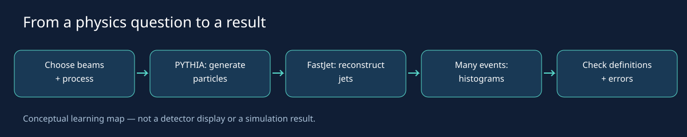

# Pythia Lab

**Learn particle collisions by generating events, asking questions, and checking your answers.**



## My motivation

I started this project because I wanted to understand what happens when particles
collide at high energies—not only by reading about it, but by writing code and
seeing the results for myself. Learning to turn a physics question into a simulation
has made this amazing world feel more accessible.

I want others to enjoy that same experience: ask questions, make predictions,
run the examples, and learn from what surprises you. You do not need to know
everything before starting. Curiosity, patience, and a willingness to check your
ideas are enough to begin. Corrections, clearer explanations, and thoughtful
contributions are welcome. I hope this small project helps more people explore
and contribute to particle physics.

## Start here

This is a C++ learning project using **PYTHIA 8.318** and **FastJet 3.5.2**, with
Python for plots. It models proton–proton collisions at particle level.
It is not an official CERN, Fermilab, ATLAS or CMS project, and does not simulate
a complete detector or make precision discovery claims.

1. Follow [installation](docs/installation.md).
2. Work through the [learning path](docs/learning-path.md).
3. Keep the [glossary](docs/glossary.md) nearby.
4. Read [physics and real experiments](docs/concepts.md).

On Linux Mint / Ubuntu, after installing prerequisites:

```bash
bash scripts/install-local.sh
source scripts/env.sh
bash lessons/01-compare-to-data/data/fetch_hepdata.sh
bash scripts/test-analysis.sh
bash scripts/check.sh
```

The download step is required for Lesson 01. No downloaded data, compiled binaries,
third-party libraries or simulation results are distributed here. Generate your
own outputs and keep them out of version control. The diagrams are explanatory
illustrations, not simulated results or detector displays.

| Lesson | Question | Guide |
|---|---|---|
| Setup | Can PYTHIA and FastJet work together? | [Setup](docs/installation.md) |
| 00 | What is inside a collision record? | [First collision](docs/00-first-collision.md) |
| 01 | How do we compare the same observable with ATLAS? | [Compare to data](docs/01-compare-to-data.md) |
| 02 | How do different production processes look? | [Processes](docs/02-physics-processes.md) |
| 03 | How do jet momentum, mass and multiplicity behave? | [Jets](docs/03-jets.md) |
| 04 | What would measurement change? | [Detector effects](docs/04-detector-effects.md), conceptual only |

## Files and results

`lessons/` contains programs and plot scripts; `scripts/` contains installation,
running and validation helpers; `tests/` contains focused regression checks.
`docs/` contains explanations and original schematic diagrams.

`bash scripts/check.sh` runs 2,000 event attempts per sample (10 in Lesson 00,
one in setup), creates plots and saves a dated copy in `runs/`. Logs retain
PYTHIA diagnostics. Read them even when the program exits successfully.
`NEVENTS=100 bash scripts/check.sh` is a shorter software check, not a physics study.

## Scope and next steps

These lessons include primary-particle selection, published bin boundaries and
per-bin MC statistical errors for Lessons 01 and 03. They do not include full
covariance matrices, systematic uncertainty studies or detector response.
Lesson 02 retains an inclusive charged-particle definition for qualitative comparisons.

See [contributing](CONTRIBUTING.md) and [references](docs/references.md).
