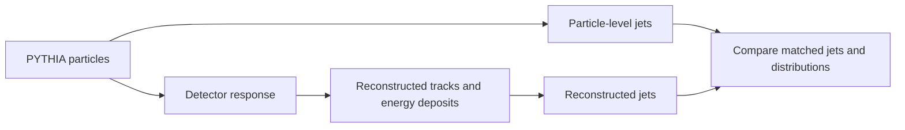

# Detector effects: what the next lesson will add

This is an explanation and plan, not an implemented detector simulation.

PYTHIA produces a particle-level event. FastJet can cluster that event into
particle-level jets. A real detector instead measures electrical signals left
by particles, and reconstruction algorithms infer tracks, energy deposits and jets.

| Effect | Example | Consequence |
|---|---|---|
| Acceptance | A particle travels beyond tracking coverage | It is not measured in that system |
| Efficiency | A track inside the coverage is missed | Measured multiplicity decreases |
| Resolution | A true 100 GeV jet is reconstructed at 94 or 107 GeV | Events migrate between bins |
| Calibration | Reconstructed energies are systematically too high | The spectrum shifts, not just fluctuates |
| Pile-up | Other pp collisions happen in the same bunch crossing | Extra particles and energy enter the event |
| Misidentification | A light jet is labelled as a b jet | Background enters a selected sample |

The 94 and 107 GeV values are illustrative, not ATLAS performance numbers.

A jet count can change even without “losing a jet”: a true jet near a 30 GeV cut
may fluctuate below the cut after measurement. This is why detector effects affect
both shapes and event selection, not just the precision of a plotted point.

An educational first step could apply an explicitly labelled toy efficiency and
resolution model to particles, recluster them, and compare truth and reconstructed
jets. That would teach migration and bias but would not reproduce ATLAS. A more
realistic study needs a documented detector simulation and a validated detector
configuration. Neither is implemented in this repository.

**For Lesson 01, do not simply smear the simulation before comparing.** The ATLAS
tables used there were corrected to particle level. Compare those with a matching
particle-level definition. A detector-response study is appropriate for raw or
reconstructed-level measurements, or for studying how those corrections work.
See [the measurement](https://arxiv.org/abs/1602.01633).

Statistical errors from generating more events do not cover detector uncertainty.
A later detector study should vary efficiency, calibration and resolution within
justified uncertainties, then repeat the full selection and reconstruction.
