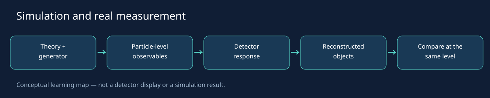
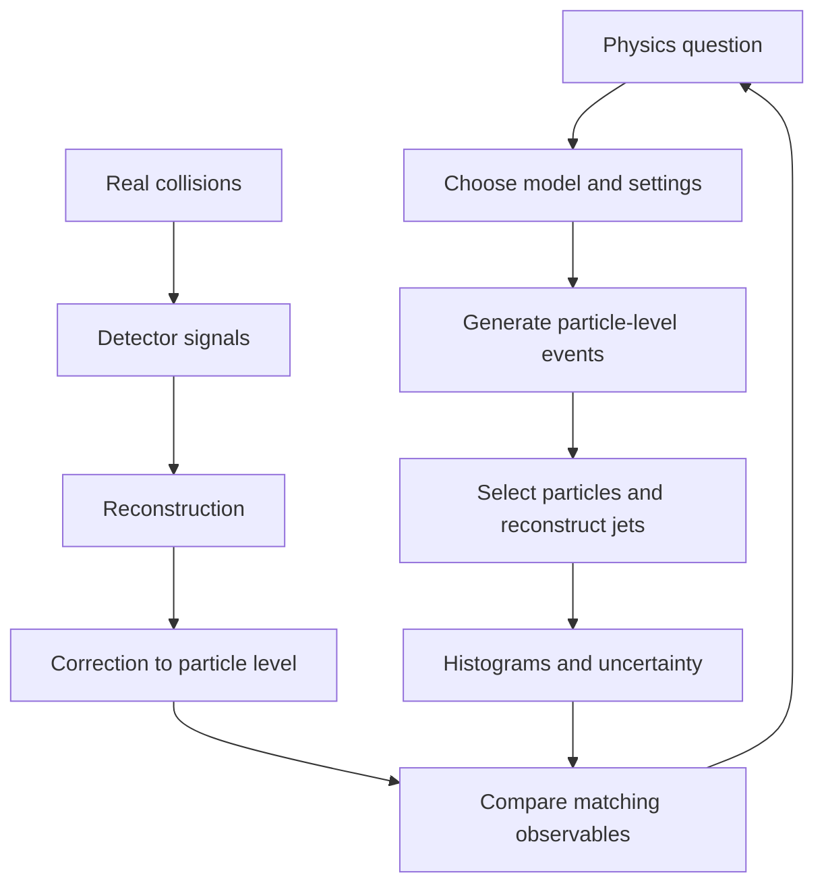

# From theory to real experiments

A Monte Carlo generator samples possible outcomes from a specified physics model.
PYTHIA combines the hard interaction with showers, additional parton interactions,
hadronization and decays. An event record is a model outcome, not a detector photograph.
FastJet groups selected particles into reproducibly defined jets. Many events produce
histograms that can be compared with consistently defined measurements.

## CERN and Fermilab

At [CERN's LHC](https://home.cern/science/accelerators/large-hadron-collider),
protons or ions are accelerated and collided. Experiments reconstruct objects from
detector signals. The pp examples here illustrate a small part of that analysis chain;
they are not the experimental software or an exact description of its detector.

[Fermilab](https://www.fnal.gov/pub/science/particle-physics/) has major neutrino
research programs and participates in CMS at the LHC. A proton beam striking a target
to produce neutrinos is different from two proton beams colliding. This repository
does not simulate a neutrino beamline or neutrino detector. Shared ideas include
statistical sampling, detector calibration and comparing well-defined observables.

## Jets and radius

A jet is a reconstructed group of particles, not a fundamental particle. Its mass
comes from the combined four-vector. The radius R sets a distance scale in rapidity
and azimuth, not simply an angle in radians. Larger R can collect wider radiation,
merge nearby jets and move jets across momentum cuts. These effects compete.

## Scope

More events reduce statistical fluctuations, not model bias. The lessons do not
include full detector response, systematic variations, full covariance matrices,
or a search for new particles. Top production alone is not a new-particle hypothesis;
a search requires a specified signal model, background prediction and statistical test.

## How simulation meets observation

